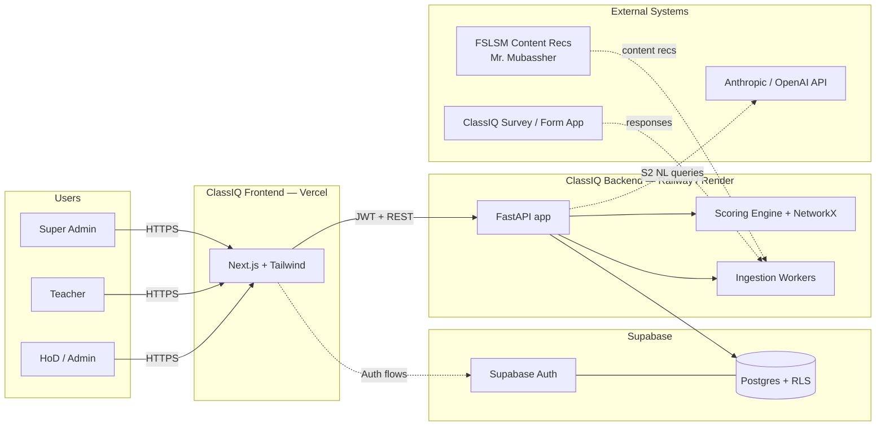
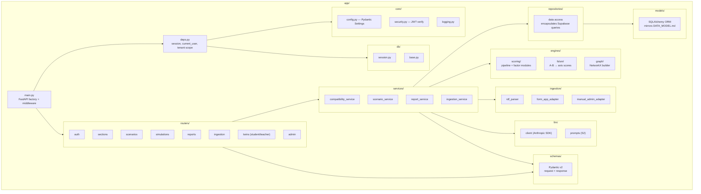
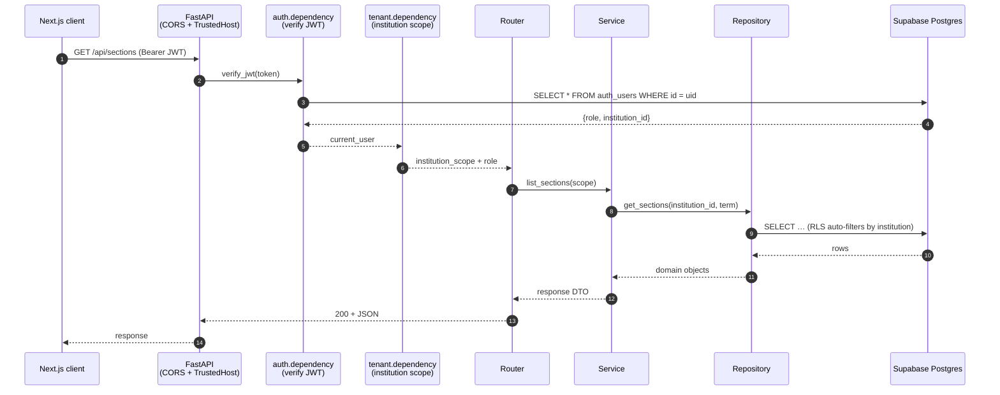
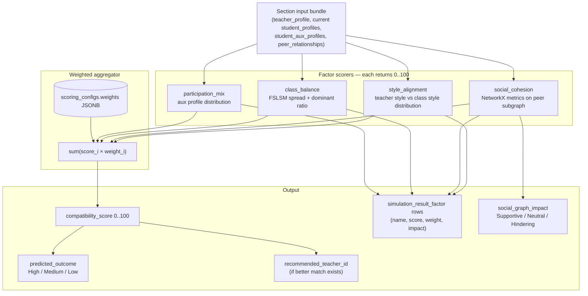
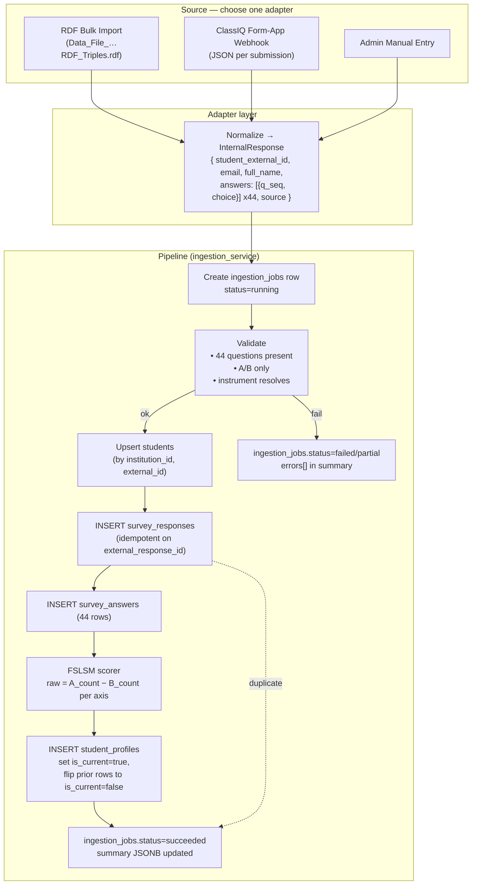
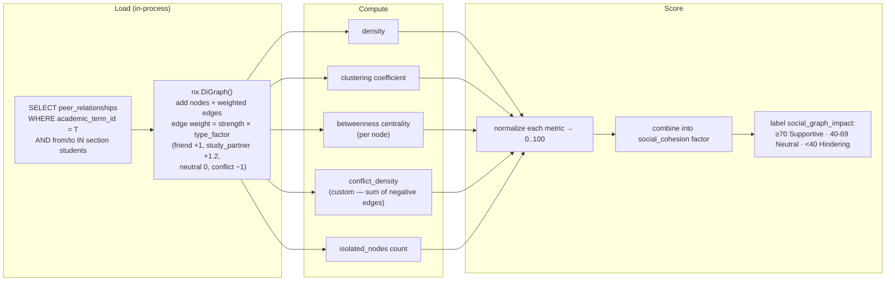
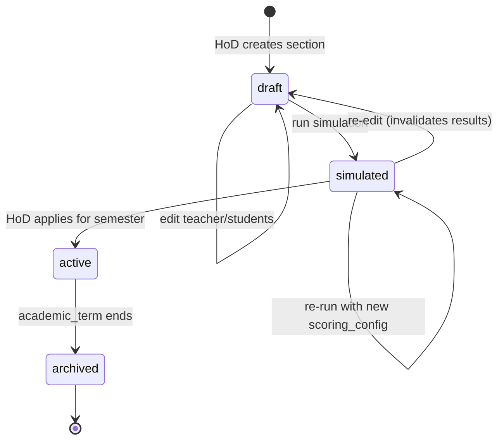
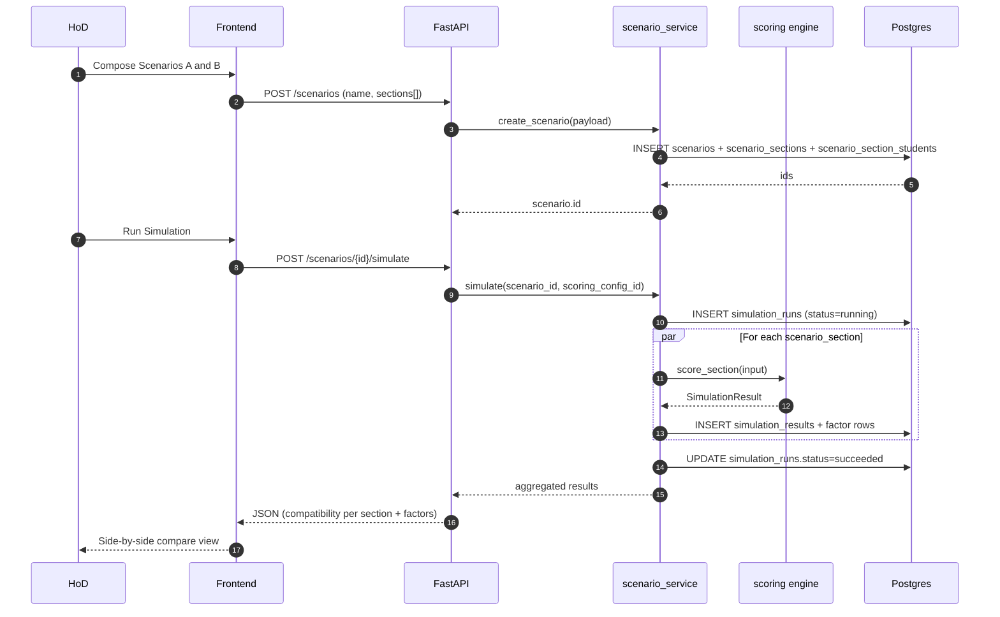
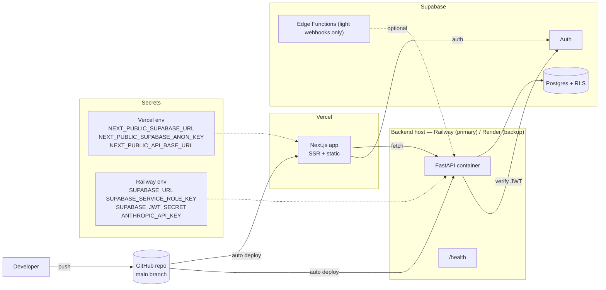
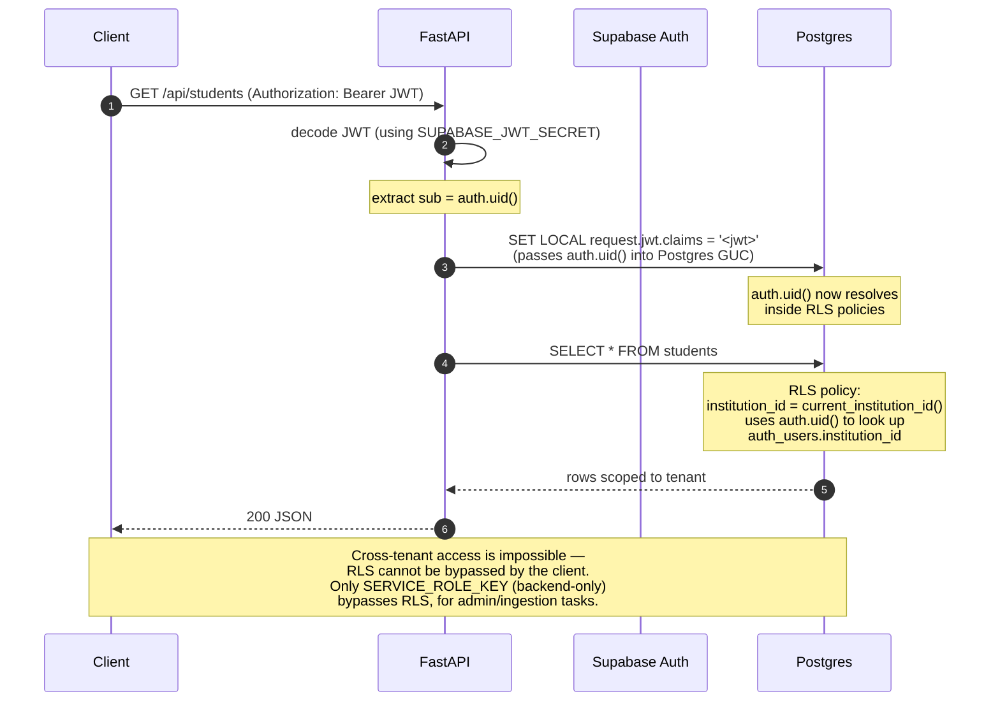

# ClassIQ — Backend Architecture

**Status:** Draft v1 — 2026-05-11 · §5, §11 and §13 updated to the as-built state on 2026-09-04
**Owner:** Khubaib (backend lead)
**Stack:** Python 3.12 · FastAPI · SQLAlchemy 2.x · Pydantic v2 · NetworkX · Supabase Postgres · Anthropic SDK
**Related:** [DATA_MODEL.md](DATA_MODEL.md) · [project.md](../project.md)

---

## 1. System Context



**Notes**
- Frontend talks REST to FastAPI only (no direct DB writes from client beyond what Supabase Auth needs).
- Supabase Auth issues the JWT; FastAPI verifies it and resolves the institution scope.
- The ClassIQ form-app is *upstream* — it pushes to Ingestion, never the reverse. Mr. Mubassher's FSLSM is the external source of teaching content recommendations only.

---

## 2. FastAPI Module Layout



**Layering rule:** routers → services → (repositories | engines | adapters). Repositories own DB access; engines own pure computation; routers stay thin.

---

## 3. Request Flow (auth + tenant + service)



**Two guarantees enforced here**
- JWT verification on every request (no anonymous calls except `/health`, `/auth/*`).
- RLS is enforced at DB level using the Postgres `auth.uid()` from the Supabase-issued JWT — application code never has to add `WHERE institution_id = X` manually.

---

## 4. Scoring Engine Pipeline (F2)



**Engine contract**

```
score_section(section_input, scoring_config) -> SimulationResult
  where SimulationResult contains:
    compatibility_score, factors[], predicted_outcome,
    social_graph_impact, recommended_teacher_id, style_distribution
```

Each factor scorer is a pure function `(input) -> (score, evidence)`. The aggregator is the only place weights are read. Factor weights live in `scoring_configs.weights` JSONB so the team can tune without DDL changes — see [DATA_MODEL.md §10](DATA_MODEL.md).

---

## 5. Ingestion Pipeline (RDF / form-app → DB)



**Key properties**
- **Idempotent.** `UNIQUE (instrument_id, external_response_id)` on `survey_responses` means re-running the same import is safe.
- **Source-agnostic.** Adapters normalize to one internal shape — the pipeline downstream is unaware of the origin.
- **Re-scoreable.** Raw answers stored separately from derived scores. If the FSLSM scorer changes, re-run scoring without re-collecting responses.
- **As built (Sep 2026):** adapters in `app/ingestion/` (`rdf_parser`, `csv_adapter`, `form_app_adapter`, `manual_admin_adapter`) normalise to `InternalResponse`; `services/ingestion_service.py` runs the pipeline with a savepoint per response so one bad row never sinks a batch, and `dry_run=True` validates without writing. The default ILS instrument is defined in `app/ingestion/ils_instrument.py` and seeded on first use (also `db/migrations/2026-09-04_seed_ils_instrument.sql`).

---

## 6. NetworkX Integration



**Why in-process:** classroom-sized graphs (30–200 students) fit in RAM trivially. No separate graph service required. Graph is constructed fresh per simulation; no NetworkX state is persisted.

**Persistence model:** edges live in Postgres (`peer_relationships`); graph objects are ephemeral.

---

## 7. Section State Machine



**Invariants**
- Cannot move `draft → active` directly; must `simulated` first (forces an informed decision).
- Editing a `simulated` section drops it back to `draft` and orphans prior `simulation_runs` (kept for audit, not shown to user).
- Only one `active` section per `(course, academic_term, label)` at a time (UNIQUE constraint in DATA_MODEL §5).

---

## 8. Scenario Simulation Flow (F5)



**Parallelism note:** if scenario count or section count is high, run section-level scoring concurrently via `asyncio.gather` over thread-bound calls (NetworkX work is CPU-bound but small per section).

---

## 9. Deployment Topology



**Decision points**
- Railway is the primary backend host per [project.md §14](../project.md). Render is the documented fallback if Railway free-tier ToS changes.
- `SUPABASE_SERVICE_ROLE_KEY` lives **only** in the backend env. Frontend uses `ANON_KEY` (RLS-bound).
- Anthropic key is backend-only (S2 stretch goal).

---

## 10. Multi-Tenant Request Lifecycle



**Tenant-scoped service role usage:** for ingestion and super-admin actions, the backend connects with `SERVICE_ROLE_KEY` and explicitly passes `institution_id` in queries — RLS bypass is intentional but always paired with explicit scoping.

---

## 11. API Surface (as built — 4 September 2026)

Every route is under `/api` except the health probes. Roles: **staff** = hod, institution_admin, super_admin. The live OpenAPI document at `/docs` is authoritative.

| Method | Path | Auth | Purpose |
|---|---|---|---|
| `GET` | `/health`, `/ready` | public | Liveness / DB readiness |
| `GET` | `/api/me` | any | Current user + role + institution |
| `GET` | `/api/students`, `/api/students/{id}` | staff | Roster + current profile |
| `GET` | `/api/students/{id}/profile-history` | staff | S3 — every profile version with term + source |
| `GET` | `/api/teachers`, `/api/teachers/{id}` | staff | Teachers + current profile |
| `GET POST` | `/api/sections` | staff | List (with latest result) / create draft |
| `GET PATCH DELETE` | `/api/sections/{id}` | staff | Detail / label + teacher / soft delete |
| `PUT` | `/api/sections/{id}/students` | staff | Replace roster (simulated → draft) |
| `POST` | `/api/sections/{id}/simulate` | staff | Run the engine, persist result |
| `POST` | `/api/sections/{id}/activate` · `/archive` · `/reopen` | staff | §7 state machine |
| `GET POST` | `/api/scenarios` | staff | List / create what-if scenario |
| `POST` | `/api/scenarios/from-section/{section_id}` | staff | Clone a live section into a scenario |
| `GET PATCH DELETE` | `/api/scenarios/{id}` | staff | Detail / edit / delete |
| `POST` | `/api/scenarios/{id}/simulate` | staff | Score every scenario section (one run) |
| `GET` | `/api/scenarios/{id}/compare` | staff | Side-by-side vs live baseline, factor deltas, roster diff |
| `POST` | `/api/scenarios/{id}/apply` | staff | Copy onto live sections + re-score |
| `GET` | `/api/reports/sections/{id}` | staff, teacher (own) | F6 report payload + run history |
| `POST` | `/api/ingestion/rdf` · `/csv` | staff | Bulk import (multipart; `dry_run` form field) |
| `POST` | `/api/ingestion/form` · `/manual` | staff | Form-app JSON / one typed submission |
| `GET` | `/api/ingestion/jobs`, `/jobs/{id}`, `/instrument` | staff | Job history, one job, the 44-question ILS |
| `GET` | `/api/analytics/longitudinal` | staff | S3 cohort drift per term / version, top shifts |
| `GET` | `/api/early-warning/overview`, `/flags` | staff | S1 dashboard + flag list |
| `PATCH` | `/api/early-warning/flags/{id}` | staff | acknowledge / resolve / reopen |
| `GET POST` | `/api/early-warning/sections/{id}/outcomes` | staff, teacher (own) | Read / record weekly actuals |
| `POST` | `/api/early-warning/sections/{id}/evaluate` | staff, teacher (own) | Re-run the comparator |
| `GET` | `/api/llm/status` · `POST /api/llm/query` | staff | S2 Ask ClassIQ |
| `GET POST PATCH` | `/api/admin/institutions` | super_admin | Tenant management |
| `GET` | `/api/admin/system/overview` · `/audit` · `/ingestion-jobs` | super_admin | Platform-wide views |
| `GET POST PATCH DELETE` | `/api/institution/departments` (+ `/hods`) | admin | Departments, HoD assignment |
| `GET POST PATCH` | `/api/institution/users` (+ `/import/preview`, `/import/commit`) | admin | User provisioning, CSV import |
| `GET POST PATCH DELETE` | `/api/institution/courses` | staff | Course catalogue (audited) |
| `GET` | `/api/institution/analytics/overview` · `/departments/{id}` · `/score-trend` · `/simulations-by-department` | admin | Institution analytics |
| `GET` | `/api/institution/audit` | admin | Tenant audit tail |

Pydantic schemas live in `app/schemas/` and mirror the DB shapes from DATA_MODEL with optional fields per route.

---

## 12. Cross-Cutting Concerns

| Concern | Approach |
|---|---|
| Logging | structured JSON via `structlog`; correlation_id per request |
| Errors | one `APIError` base class → mapped to HTTP via exception handler |
| Validation | Pydantic v2 on all request/response; `Field(..., examples=[...])` for OpenAPI |
| Migrations | Alembic against Supabase Postgres; checked into `backend/alembic/` |
| Tests | `pytest` + `pytest-asyncio`; test DB is a separate Supabase project or local Postgres; **RLS policy tests live in `tests/rls/`** and run as different JWT subjects |
| Performance | scoring engine functions are pure → easy to memoize per `(section_id, scoring_config_id)` if needed |
| Secrets | never in code; loaded via `pydantic-settings` from env |
| LLM cost | system prompt cached (Anthropic prompt caching); per-query token cap; no PII in prompts |

---

## 13. Open Items

- **Apply the 2026-09-04 migrations** (`db/migrations/2026-09-04_seed_ils_instrument.sql`, `2026-09-04_early_warning.sql`) to the shared Supabase project — it was unreachable when they were written; both are idempotent.
- **Per-role RLS policy matrix** — currently described in [DATA_MODEL.md §12](DATA_MODEL.md); needs explicit per-table/per-role read/write table. `tests/rls/test_rls_isolation.py` is the executable check once `TEST_DATABASE_URL` points at a seeded database.
- **Scoring weights starting values** — defaults are seeded (0.40 / 0.25 / 0.20 / 0.15); tune with Mr. Mubassher's input.
- **Early-warning expectation bands** (`engines/early_warning.py::EXPECTED`) — first-pass thresholds; calibrate against a real semester.
- **NetworkX type_factor weights** for edge type → numeric — tune empirically.
- **Job queue** — ingestion + simulation still run synchronously inside the request; the 176-student RDF import completes well inside a request, but introduce `arq` / `RQ` if bulk imports grow.
- **LLM cost telemetry** — `/api/llm/query` logs token usage to `audit_logs`; add a per-institution monthly cap if the stretch goal ships to real users.
