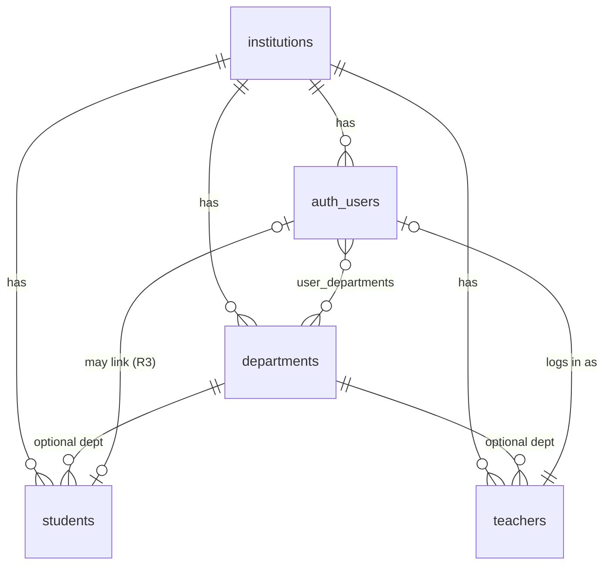
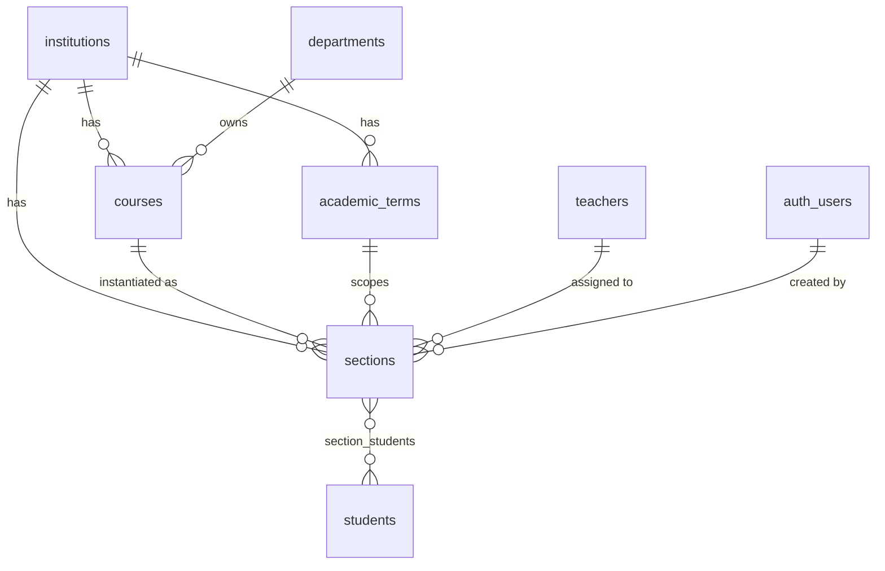
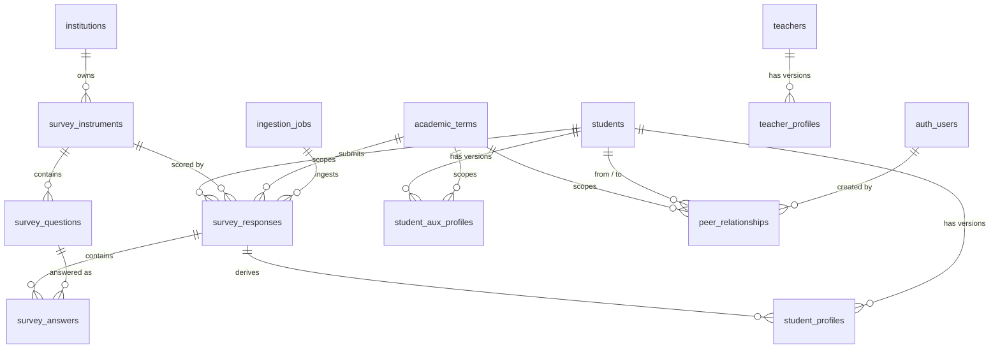
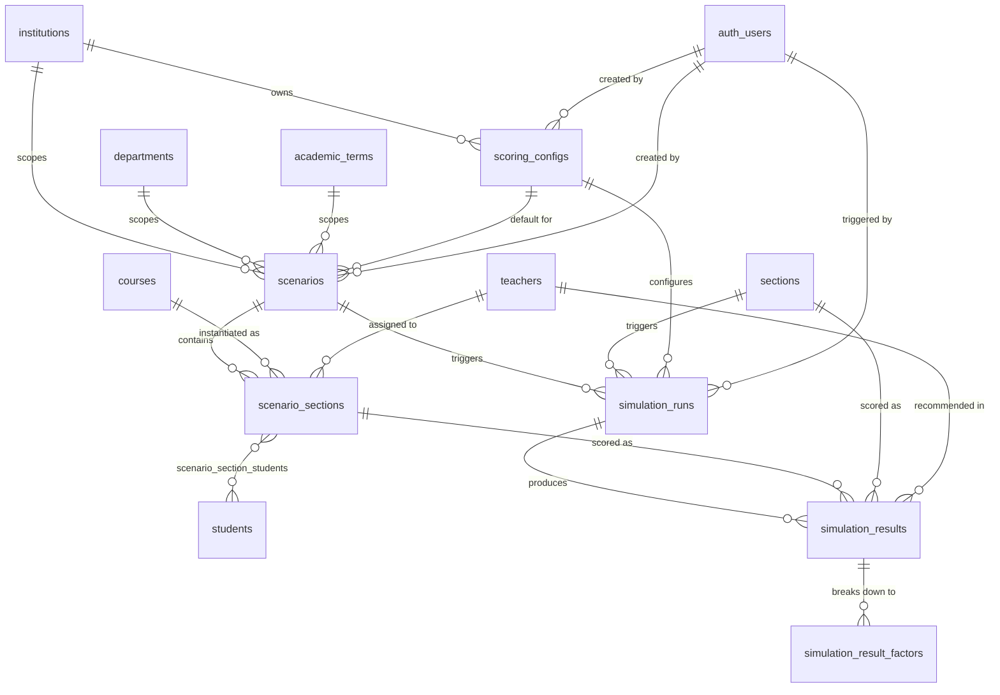
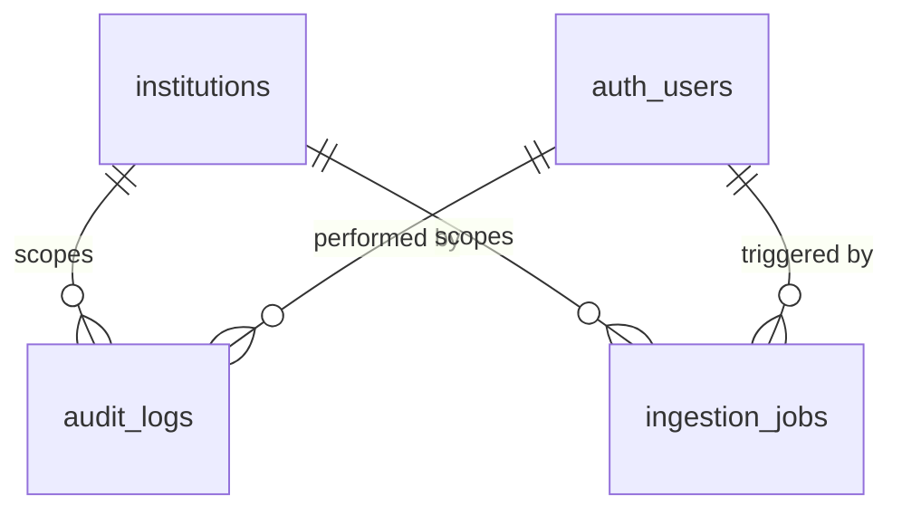

# ClassIQ — Data Model & Database Schema

**Status:** Draft v1 — 2026-05-11
**Owners:** Khubaib (backend/DB), Adnan (frontend), Muniba (design)
**Master spec:** [project.md](../project.md)

---

## 1. Philosophy

- **One Supabase Postgres database. Multi-tenant via `institution_id` + RLS** (not schema-per-tenant, not separate DBs). Spec §F8.
- **Store raw and derived separately.** Survey answers are stored verbatim; FSLSM scores are derived rows that can be re-computed when the scoring logic evolves. Never collect again.
- **Profiles are versioned, not mutated.** Every new survey submission creates a new `student_profile` row; the previous one stays untouched. This is what unlocks S3 longitudinal analytics later.
- **Scenarios are first-class, separate from real sections.** Hypotheticals never pollute live academic data; "applying" a scenario is an explicit copy operation.
- **Hard-delete drafts and computables; soft-delete people and academic record.** Anything we can re-derive can be dropped; anything that *is* the data is preserved.
- **Source-agnostic ingestion.** The schema does not assume a single upstream — ClassIQ's own form/survey app, a bulk RDF import, and manual admin entry all converge on the same tables.

---

## 2. Naming Conventions

| Item | Convention | Example |
|---|---|---|
| Tables | plural snake_case | `student_profiles` |
| Columns | snake_case | `dominant_axis` |
| Primary keys | `id UUID DEFAULT gen_random_uuid()` | |
| Foreign keys | `<table_singular>_id` | `institution_id` |
| Timestamps | `created_at`, `updated_at`, `deleted_at` (TIMESTAMPTZ) | |
| Enums | Postgres ENUM types | `section_state` |
| Booleans | `is_<adjective>` | `is_current` |

---

## 3. Enum Types

```sql
CREATE TYPE user_role         AS ENUM ('super_admin', 'hod', 'teacher');
CREATE TYPE section_state     AS ENUM ('draft', 'simulated', 'active', 'archived');
CREATE TYPE collab_pref       AS ENUM ('solo', 'pair', 'group');
CREATE TYPE participation_lvl AS ENUM ('low', 'medium', 'high');
CREATE TYPE interaction_lvl   AS ENUM ('low', 'medium', 'high');
CREATE TYPE pacing_pref       AS ENUM ('slow', 'moderate', 'fast');
CREATE TYPE fslsm_axis        AS ENUM (
  'active_reflective',
  'sensing_intuitive',
  'visual_verbal',
  'sequential_global'
);
CREATE TYPE fslsm_pole_a      AS ENUM ('active', 'sensing', 'visual', 'sequential');
CREATE TYPE fslsm_pole_b      AS ENUM ('reflective', 'intuitive', 'verbal', 'global');
CREATE TYPE answer_choice     AS ENUM ('A', 'B');
CREATE TYPE response_source   AS ENUM (
  'rdf_bulk_import',       -- existing RDF dump
  'form_app',              -- ClassIQ's own survey/form app
  'classiq_internal',      -- future ClassIQ-owned survey
  'manual_admin'           -- typed in by an admin
);
CREATE TYPE relationship_type AS ENUM ('friend', 'study_partner', 'neutral', 'conflict');
CREATE TYPE relationship_src  AS ENUM ('survey', 'admin');
CREATE TYPE scenario_status   AS ENUM ('draft', 'simulated', 'applied', 'archived');
CREATE TYPE sim_run_status    AS ENUM ('queued', 'running', 'succeeded', 'failed');
CREATE TYPE factor_impact     AS ENUM ('positive', 'neutral', 'negative');
CREATE TYPE predicted_outcome AS ENUM ('high', 'medium', 'low');
CREATE TYPE social_impact     AS ENUM ('supportive', 'neutral', 'hindering');
CREATE TYPE ingestion_status  AS ENUM ('pending', 'running', 'succeeded', 'failed', 'partial');
```

> **Changed enums** are not edited in place once the DB is live — Postgres can't drop
> an enum value. They go through a versioned migration instead. `response_source`
> dropped its old `phd_pipeline` value (merged into `form_app`) — see §18 Migrations.

---

## 4. Tables — Group A: Tenancy

### `institutions`
```sql
CREATE TABLE institutions (
  id          UUID PRIMARY KEY DEFAULT gen_random_uuid(),
  name        TEXT NOT NULL,
  slug        TEXT NOT NULL UNIQUE,
  created_at  TIMESTAMPTZ NOT NULL DEFAULT now(),
  updated_at  TIMESTAMPTZ,
  deleted_at  TIMESTAMPTZ
);
```

### `departments`
```sql
CREATE TABLE departments (
  id              UUID PRIMARY KEY DEFAULT gen_random_uuid(),
  institution_id  UUID NOT NULL REFERENCES institutions(id) ON DELETE CASCADE,
  name            TEXT NOT NULL,
  code            TEXT NOT NULL,
  created_at      TIMESTAMPTZ NOT NULL DEFAULT now(),
  updated_at      TIMESTAMPTZ,
  deleted_at      TIMESTAMPTZ,
  UNIQUE (institution_id, code)
);
CREATE INDEX idx_departments_institution ON departments(institution_id);
```

### `auth_users` — extends Supabase `auth.users`
```sql
CREATE TABLE auth_users (
  id              UUID PRIMARY KEY REFERENCES auth.users(id) ON DELETE CASCADE,
  institution_id  UUID NOT NULL REFERENCES institutions(id) ON DELETE CASCADE,
  role            user_role NOT NULL,
  full_name       TEXT NOT NULL,
  email           TEXT NOT NULL,
  is_active       BOOLEAN NOT NULL DEFAULT true,
  created_at      TIMESTAMPTZ NOT NULL DEFAULT now(),
  updated_at      TIMESTAMPTZ
);
CREATE INDEX idx_auth_users_institution_role ON auth_users(institution_id, role);
```
Note: `auth.users` is Supabase-managed; this table holds our extension fields. RLS policies join on `auth.uid() = auth_users.id`.

### `user_departments` — N-to-N for multi-department HoDs
```sql
CREATE TABLE user_departments (
  auth_user_id   UUID NOT NULL REFERENCES auth_users(id) ON DELETE CASCADE,
  department_id  UUID NOT NULL REFERENCES departments(id) ON DELETE CASCADE,
  created_at     TIMESTAMPTZ NOT NULL DEFAULT now(),
  PRIMARY KEY (auth_user_id, department_id)
);
CREATE INDEX idx_user_departments_department ON user_departments(department_id);
```

---

## 5. Tables — Group B: Academic Structure

### `academic_terms`
```sql
CREATE TABLE academic_terms (
  id              UUID PRIMARY KEY DEFAULT gen_random_uuid(),
  institution_id  UUID NOT NULL REFERENCES institutions(id) ON DELETE CASCADE,
  name            TEXT NOT NULL,                    -- "Fall 2026"
  starts_on       DATE NOT NULL,
  ends_on         DATE NOT NULL,
  is_active       BOOLEAN NOT NULL DEFAULT false,
  created_at      TIMESTAMPTZ NOT NULL DEFAULT now(),
  UNIQUE (institution_id, name),
  CHECK (ends_on > starts_on)
);
CREATE INDEX idx_academic_terms_institution_active ON academic_terms(institution_id, is_active);
```

### `courses`
```sql
CREATE TABLE courses (
  id              UUID PRIMARY KEY DEFAULT gen_random_uuid(),
  institution_id  UUID NOT NULL REFERENCES institutions(id) ON DELETE CASCADE,
  department_id   UUID NOT NULL REFERENCES departments(id) ON DELETE CASCADE,
  code            TEXT NOT NULL,                    -- "CS201"
  name            TEXT NOT NULL,                    -- "Data Structures"
  created_at      TIMESTAMPTZ NOT NULL DEFAULT now(),
  deleted_at      TIMESTAMPTZ,
  UNIQUE (department_id, code)
);
CREATE INDEX idx_courses_institution ON courses(institution_id);
CREATE INDEX idx_courses_department  ON courses(department_id);
```

### `sections`
```sql
CREATE TABLE sections (
  id                UUID PRIMARY KEY DEFAULT gen_random_uuid(),
  institution_id    UUID NOT NULL REFERENCES institutions(id) ON DELETE CASCADE,
  course_id         UUID NOT NULL REFERENCES courses(id) ON DELETE CASCADE,
  academic_term_id  UUID NOT NULL REFERENCES academic_terms(id) ON DELETE CASCADE,
  teacher_id        UUID REFERENCES teachers(id) ON DELETE SET NULL,
  label             TEXT NOT NULL,                  -- "A", "B", "evening"
  state             section_state NOT NULL DEFAULT 'draft',
  created_by        UUID NOT NULL REFERENCES auth_users(id),
  created_at        TIMESTAMPTZ NOT NULL DEFAULT now(),
  updated_at        TIMESTAMPTZ,
  deleted_at        TIMESTAMPTZ,
  UNIQUE (course_id, academic_term_id, label)
);
CREATE INDEX idx_sections_term_state    ON sections(academic_term_id, state);
CREATE INDEX idx_sections_teacher       ON sections(teacher_id);
CREATE INDEX idx_sections_institution   ON sections(institution_id);
```

### `section_students`
```sql
CREATE TABLE section_students (
  section_id   UUID NOT NULL REFERENCES sections(id) ON DELETE CASCADE,
  student_id   UUID NOT NULL REFERENCES students(id) ON DELETE CASCADE,
  added_at     TIMESTAMPTZ NOT NULL DEFAULT now(),
  removed_at   TIMESTAMPTZ,                         -- soft-delete on the link
  PRIMARY KEY (section_id, student_id)
);
CREATE INDEX idx_section_students_student ON section_students(student_id);
```

---

## 6. Tables — Group C: People as Data Subjects

### `students`
```sql
CREATE TABLE students (
  id                    UUID PRIMARY KEY DEFAULT gen_random_uuid(),
  institution_id        UUID NOT NULL REFERENCES institutions(id) ON DELETE CASCADE,
  department_id         UUID REFERENCES departments(id),
  external_id           TEXT,                       -- SP23-BSCS-0179 etc.
  full_name             TEXT NOT NULL,
  email                 TEXT,                       -- nullable; ingested from RDF when present
  linked_auth_user_id   UUID REFERENCES auth_users(id) ON DELETE SET NULL,  -- R3 future
  created_at            TIMESTAMPTZ NOT NULL DEFAULT now(),
  updated_at            TIMESTAMPTZ,
  deleted_at            TIMESTAMPTZ,
  UNIQUE (institution_id, external_id)
);
CREATE INDEX idx_students_institution ON students(institution_id);
CREATE INDEX idx_students_department  ON students(department_id);
CREATE INDEX idx_students_email       ON students(email) WHERE email IS NOT NULL;
```

### `teachers`
```sql
CREATE TABLE teachers (
  id                    UUID PRIMARY KEY DEFAULT gen_random_uuid(),
  institution_id        UUID NOT NULL REFERENCES institutions(id) ON DELETE CASCADE,
  department_id         UUID REFERENCES departments(id),
  full_name             TEXT NOT NULL,
  email                 TEXT NOT NULL,
  auth_user_id          UUID NOT NULL REFERENCES auth_users(id) ON DELETE CASCADE,  -- teachers log in (F7)
  created_at            TIMESTAMPTZ NOT NULL DEFAULT now(),
  updated_at            TIMESTAMPTZ,
  deleted_at            TIMESTAMPTZ,
  UNIQUE (institution_id, email)
);
CREATE INDEX idx_teachers_institution ON teachers(institution_id);
CREATE INDEX idx_teachers_auth_user   ON teachers(auth_user_id);
```

---

## 7. Tables — Group D: Survey Instrument

### `survey_instruments`
```sql
CREATE TABLE survey_instruments (
  id              UUID PRIMARY KEY DEFAULT gen_random_uuid(),
  institution_id  UUID REFERENCES institutions(id),  -- NULL = global (default FSLSM ILS)
  name            TEXT NOT NULL,                     -- "FSLSM-ILS-Algorithms-27Jan24"
  version         TEXT NOT NULL,                     -- "1.0"
  total_questions INT NOT NULL CHECK (total_questions > 0),
  is_published    BOOLEAN NOT NULL DEFAULT false,
  created_at      TIMESTAMPTZ NOT NULL DEFAULT now(),
  UNIQUE (name, version)
);
```

### `survey_questions`
```sql
CREATE TABLE survey_questions (
  id              UUID PRIMARY KEY DEFAULT gen_random_uuid(),
  instrument_id   UUID NOT NULL REFERENCES survey_instruments(id) ON DELETE CASCADE,
  sequence_no     INT NOT NULL,                      -- 1..44
  question_text   TEXT NOT NULL,
  axis            fslsm_axis NOT NULL,
  rdf_property    TEXT,                              -- column name from the RDF file, for ingestion mapping
  -- The A/B → pole mapping. In standard ILS, A always maps to the same pole within an axis,
  -- but some questions may be reversed. Encoded per-question for safety.
  answer_a_pole   fslsm_pole_a NOT NULL,             -- e.g. 'active'
  answer_b_pole   fslsm_pole_b NOT NULL,             -- e.g. 'reflective'
  created_at      TIMESTAMPTZ NOT NULL DEFAULT now(),
  UNIQUE (instrument_id, sequence_no)
);
CREATE INDEX idx_survey_questions_instrument_axis ON survey_questions(instrument_id, axis);
```

---

## 8. Tables — Group E: Responses + Profiles (Versioned Core)

### `survey_responses`
```sql
CREATE TABLE survey_responses (
  id                   UUID PRIMARY KEY DEFAULT gen_random_uuid(),
  institution_id       UUID NOT NULL REFERENCES institutions(id) ON DELETE CASCADE,
  student_id           UUID NOT NULL REFERENCES students(id) ON DELETE CASCADE,
  instrument_id        UUID NOT NULL REFERENCES survey_instruments(id),
  academic_term_id     UUID REFERENCES academic_terms(id),  -- nullable: pre-ingestion data may not know term
  submitted_at         TIMESTAMPTZ NOT NULL,
  source               response_source NOT NULL,
  ingestion_job_id     UUID REFERENCES ingestion_jobs(id),   -- nullable for non-bulk sources
  external_response_id TEXT,                                  -- the source app's own response ID, for idempotency
  created_at           TIMESTAMPTZ NOT NULL DEFAULT now(),
  deleted_at           TIMESTAMPTZ,
  UNIQUE (instrument_id, external_response_id)               -- idempotent ingestion
);
CREATE INDEX idx_survey_responses_student ON survey_responses(student_id, submitted_at DESC);
CREATE INDEX idx_survey_responses_inst    ON survey_responses(institution_id);
```

### `survey_answers`
```sql
CREATE TABLE survey_answers (
  response_id   UUID NOT NULL REFERENCES survey_responses(id) ON DELETE CASCADE,
  question_id   UUID NOT NULL REFERENCES survey_questions(id),
  choice        answer_choice NOT NULL,                       -- 'A' or 'B'
  PRIMARY KEY (response_id, question_id)
);
CREATE INDEX idx_survey_answers_question ON survey_answers(question_id);
```

### `student_profiles` — the versioned digital twin (F1)
```sql
CREATE TABLE student_profiles (
  id                          UUID PRIMARY KEY DEFAULT gen_random_uuid(),
  institution_id              UUID NOT NULL REFERENCES institutions(id) ON DELETE CASCADE,
  student_id                  UUID NOT NULL REFERENCES students(id) ON DELETE CASCADE,
  derived_from_response_id    UUID NOT NULL REFERENCES survey_responses(id),
  version                     INT NOT NULL CHECK (version > 0),
  is_current                  BOOLEAN NOT NULL DEFAULT false,
  scored_at                   TIMESTAMPTZ NOT NULL DEFAULT now(),
  scoring_engine_version      TEXT NOT NULL,                  -- "1.0.0" — which scorer ran
  -- FSLSM scores: odd integers in [-11, +11]. Sign indicates pole, magnitude indicates strength.
  active_reflective_score     INT NOT NULL CHECK (active_reflective_score BETWEEN -11 AND 11 AND active_reflective_score % 2 <> 0),
  sensing_intuitive_score     INT NOT NULL CHECK (sensing_intuitive_score BETWEEN -11 AND 11 AND sensing_intuitive_score % 2 <> 0),
  visual_verbal_score         INT NOT NULL CHECK (visual_verbal_score BETWEEN -11 AND 11 AND visual_verbal_score % 2 <> 0),
  sequential_global_score     INT NOT NULL CHECK (sequential_global_score BETWEEN -11 AND 11 AND sequential_global_score % 2 <> 0),
  dominant_axis               fslsm_axis,                     -- axis with greatest |score|, NULL if tied
  deleted_at                  TIMESTAMPTZ,
  UNIQUE (student_id, version)
);
-- One current profile per student. Partial unique index enforces it.
CREATE UNIQUE INDEX idx_student_profiles_one_current
  ON student_profiles(student_id) WHERE is_current = true AND deleted_at IS NULL;
CREATE INDEX idx_student_profiles_institution ON student_profiles(institution_id);
```

### `student_aux_profiles` — non-FSLSM survey data
```sql
CREATE TABLE student_aux_profiles (
  id                     UUID PRIMARY KEY DEFAULT gen_random_uuid(),
  institution_id         UUID NOT NULL REFERENCES institutions(id) ON DELETE CASCADE,
  student_id             UUID NOT NULL REFERENCES students(id) ON DELETE CASCADE,
  academic_term_id       UUID REFERENCES academic_terms(id),
  collaboration_pref     collab_pref,
  participation_level    participation_lvl,
  preferred_peers        UUID[],                              -- student_id array
  distracting_peers      UUID[],
  notes                  TEXT,
  is_current             BOOLEAN NOT NULL DEFAULT false,
  collected_at           TIMESTAMPTZ NOT NULL DEFAULT now(),
  deleted_at             TIMESTAMPTZ
);
CREATE UNIQUE INDEX idx_student_aux_profiles_one_current
  ON student_aux_profiles(student_id, academic_term_id) WHERE is_current = true AND deleted_at IS NULL;
```

### `teacher_profiles`
```sql
CREATE TABLE teacher_profiles (
  id                  UUID PRIMARY KEY DEFAULT gen_random_uuid(),
  institution_id      UUID NOT NULL REFERENCES institutions(id) ON DELETE CASCADE,
  teacher_id          UUID NOT NULL REFERENCES teachers(id) ON DELETE CASCADE,
  version             INT NOT NULL CHECK (version > 0),
  is_current          BOOLEAN NOT NULL DEFAULT false,
  teaching_style      TEXT NOT NULL,
  interaction_level   interaction_lvl NOT NULL,
  pacing              pacing_pref NOT NULL,
  approach            TEXT,
  collected_at        TIMESTAMPTZ NOT NULL DEFAULT now(),
  deleted_at          TIMESTAMPTZ,
  UNIQUE (teacher_id, version)
);
CREATE UNIQUE INDEX idx_teacher_profiles_one_current
  ON teacher_profiles(teacher_id) WHERE is_current = true AND deleted_at IS NULL;
```

---

## 9. Tables — Group F: Social Graph

### `peer_relationships`
```sql
CREATE TABLE peer_relationships (
  id                UUID PRIMARY KEY DEFAULT gen_random_uuid(),
  institution_id    UUID NOT NULL REFERENCES institutions(id) ON DELETE CASCADE,
  academic_term_id  UUID NOT NULL REFERENCES academic_terms(id) ON DELETE CASCADE,
  from_student_id   UUID NOT NULL REFERENCES students(id) ON DELETE CASCADE,
  to_student_id     UUID NOT NULL REFERENCES students(id) ON DELETE CASCADE,
  type              relationship_type NOT NULL,
  strength          SMALLINT NOT NULL CHECK (strength BETWEEN 1 AND 5),
  source            relationship_src NOT NULL DEFAULT 'survey',
  created_by        UUID REFERENCES auth_users(id),
  created_at        TIMESTAMPTZ NOT NULL DEFAULT now(),
  deleted_at        TIMESTAMPTZ,
  CHECK (from_student_id <> to_student_id),
  UNIQUE (academic_term_id, from_student_id, to_student_id, type)  -- avoid duplicate same-type edges
);
CREATE INDEX idx_peer_rel_from ON peer_relationships(from_student_id, academic_term_id);
CREATE INDEX idx_peer_rel_to   ON peer_relationships(to_student_id, academic_term_id);
CREATE INDEX idx_peer_rel_term ON peer_relationships(academic_term_id);
```

---

## 10. Tables — Group G: Scenarios + Simulation

### `scoring_configs`
```sql
CREATE TABLE scoring_configs (
  id              UUID PRIMARY KEY DEFAULT gen_random_uuid(),
  institution_id  UUID REFERENCES institutions(id),            -- NULL = platform default
  name            TEXT NOT NULL,
  version         TEXT NOT NULL,
  is_default      BOOLEAN NOT NULL DEFAULT false,
  weights         JSONB NOT NULL,
  /* Example weights:
     {
       "style_alignment": 0.40,
       "social_cohesion": 0.25,
       "class_balance":   0.20,
       "participation":   0.15
     }
  */
  created_by      UUID REFERENCES auth_users(id),
  created_at      TIMESTAMPTZ NOT NULL DEFAULT now(),
  UNIQUE (institution_id, name, version)
);
```

### `scenarios`
```sql
CREATE TABLE scenarios (
  id                UUID PRIMARY KEY DEFAULT gen_random_uuid(),
  institution_id    UUID NOT NULL REFERENCES institutions(id) ON DELETE CASCADE,
  department_id     UUID NOT NULL REFERENCES departments(id) ON DELETE CASCADE,
  academic_term_id  UUID NOT NULL REFERENCES academic_terms(id) ON DELETE CASCADE,
  name              TEXT NOT NULL,
  notes             TEXT,
  status            scenario_status NOT NULL DEFAULT 'draft',
  scoring_config_id UUID REFERENCES scoring_configs(id),
  created_by        UUID NOT NULL REFERENCES auth_users(id),
  created_at        TIMESTAMPTZ NOT NULL DEFAULT now(),
  updated_at        TIMESTAMPTZ
);
CREATE INDEX idx_scenarios_dept_term ON scenarios(department_id, academic_term_id);
```

### `scenario_sections`
```sql
CREATE TABLE scenario_sections (
  id           UUID PRIMARY KEY DEFAULT gen_random_uuid(),
  scenario_id  UUID NOT NULL REFERENCES scenarios(id) ON DELETE CASCADE,
  course_id    UUID NOT NULL REFERENCES courses(id),
  teacher_id   UUID NOT NULL REFERENCES teachers(id),
  label        TEXT NOT NULL,                                 -- "A", "B"
  UNIQUE (scenario_id, course_id, label)
);
```

### `scenario_section_students`
```sql
CREATE TABLE scenario_section_students (
  scenario_section_id  UUID NOT NULL REFERENCES scenario_sections(id) ON DELETE CASCADE,
  student_id           UUID NOT NULL REFERENCES students(id) ON DELETE CASCADE,
  PRIMARY KEY (scenario_section_id, student_id)
);
```

### `simulation_runs`
```sql
CREATE TABLE simulation_runs (
  id                  UUID PRIMARY KEY DEFAULT gen_random_uuid(),
  institution_id      UUID NOT NULL REFERENCES institutions(id) ON DELETE CASCADE,
  scenario_id         UUID REFERENCES scenarios(id) ON DELETE CASCADE,
  section_id          UUID REFERENCES sections(id) ON DELETE CASCADE,
  scoring_config_id   UUID NOT NULL REFERENCES scoring_configs(id),
  engine_version      TEXT NOT NULL,
  status              sim_run_status NOT NULL DEFAULT 'queued',
  started_at          TIMESTAMPTZ,
  finished_at         TIMESTAMPTZ,
  error_message       TEXT,
  triggered_by        UUID NOT NULL REFERENCES auth_users(id),
  created_at          TIMESTAMPTZ NOT NULL DEFAULT now(),
  CHECK ((scenario_id IS NOT NULL) OR (section_id IS NOT NULL))
);
CREATE INDEX idx_sim_runs_scenario ON simulation_runs(scenario_id);
CREATE INDEX idx_sim_runs_section  ON simulation_runs(section_id);
```

### `simulation_results`
```sql
CREATE TABLE simulation_results (
  id                       UUID PRIMARY KEY DEFAULT gen_random_uuid(),
  simulation_run_id        UUID NOT NULL REFERENCES simulation_runs(id) ON DELETE CASCADE,
  -- For scenario runs, points at a scenario_section. For section runs, at a section. Exactly one is set.
  scenario_section_id      UUID REFERENCES scenario_sections(id) ON DELETE CASCADE,
  section_id               UUID REFERENCES sections(id) ON DELETE CASCADE,
  compatibility_score      SMALLINT NOT NULL CHECK (compatibility_score BETWEEN 0 AND 100),
  predicted_outcome        predicted_outcome NOT NULL,
  social_graph_impact      social_impact NOT NULL,
  style_distribution       JSONB NOT NULL,
  /* style_distribution example:
     {
       "active_reflective": { "active": 60, "reflective": 40 },
       "sensing_intuitive": { "sensing": 55, "intuitive": 45 },
       "visual_verbal":     { "visual": 70, "verbal": 30 },
       "sequential_global": { "sequential": 50, "global": 50 }
     }
  */
  recommended_teacher_id   UUID REFERENCES teachers(id),
  created_at               TIMESTAMPTZ NOT NULL DEFAULT now(),
  CHECK ((scenario_section_id IS NOT NULL) OR (section_id IS NOT NULL))
);
CREATE INDEX idx_sim_results_run            ON simulation_results(simulation_run_id);
CREATE INDEX idx_sim_results_scenario_sec   ON simulation_results(scenario_section_id);
CREATE INDEX idx_sim_results_section        ON simulation_results(section_id);
```

### `simulation_result_factors` — normalized factor breakdown
```sql
CREATE TABLE simulation_result_factors (
  id                    UUID PRIMARY KEY DEFAULT gen_random_uuid(),
  simulation_result_id  UUID NOT NULL REFERENCES simulation_results(id) ON DELETE CASCADE,
  factor_name           TEXT NOT NULL,                       -- "style_alignment", "social_cohesion", ...
  score                 SMALLINT NOT NULL CHECK (score BETWEEN 0 AND 100),
  weight                NUMERIC(4,3) NOT NULL,               -- 0.250 etc.
  impact                factor_impact NOT NULL,
  UNIQUE (simulation_result_id, factor_name)
);
CREATE INDEX idx_sim_factors_result ON simulation_result_factors(simulation_result_id);
CREATE INDEX idx_sim_factors_name   ON simulation_result_factors(factor_name);  -- "which factor most often drags scores down"
```

---

## 11. Tables — Group H: Ops

### `audit_logs` — never deleted
```sql
CREATE TABLE audit_logs (
  id              UUID PRIMARY KEY DEFAULT gen_random_uuid(),
  institution_id  UUID NOT NULL REFERENCES institutions(id),
  actor_user_id   UUID REFERENCES auth_users(id),
  action          TEXT NOT NULL,                              -- "section.create", "scenario.simulate", ...
  entity_type     TEXT NOT NULL,
  entity_id       UUID,
  payload         JSONB,
  created_at      TIMESTAMPTZ NOT NULL DEFAULT now()
);
CREATE INDEX idx_audit_institution_time ON audit_logs(institution_id, created_at DESC);
CREATE INDEX idx_audit_entity ON audit_logs(entity_type, entity_id);
```

### `ingestion_jobs`
```sql
CREATE TABLE ingestion_jobs (
  id              UUID PRIMARY KEY DEFAULT gen_random_uuid(),
  institution_id  UUID NOT NULL REFERENCES institutions(id) ON DELETE CASCADE,
  source          response_source NOT NULL,
  status          ingestion_status NOT NULL DEFAULT 'pending',
  started_at      TIMESTAMPTZ,
  finished_at     TIMESTAMPTZ,
  file_path       TEXT,
  summary         JSONB,
  /* summary example:
     { "students_seen": 176, "students_created": 12, "responses_ingested": 176, "errors": [] }
  */
  triggered_by    UUID REFERENCES auth_users(id),
  created_at      TIMESTAMPTZ NOT NULL DEFAULT now()
);
```

---

## 12. RLS Strategy

All tenant-scoped tables enable RLS and use one helper function:

```sql
CREATE OR REPLACE FUNCTION current_institution_id() RETURNS UUID
LANGUAGE sql STABLE SECURITY DEFINER AS $$
  SELECT institution_id FROM auth_users WHERE id = auth.uid();
$$;

CREATE OR REPLACE FUNCTION current_role() RETURNS user_role
LANGUAGE sql STABLE SECURITY DEFINER AS $$
  SELECT role FROM auth_users WHERE id = auth.uid();
$$;
```

**Standard tenant-scope policy template** (applied to every table with `institution_id`):

```sql
ALTER TABLE <table_name> ENABLE ROW LEVEL SECURITY;

CREATE POLICY tenant_isolation ON <table_name>
  USING (institution_id = current_institution_id())
  WITH CHECK (institution_id = current_institution_id());

-- super_admin override
CREATE POLICY super_admin_all ON <table_name>
  USING (current_role() = 'super_admin')
  WITH CHECK (current_role() = 'super_admin');
```

**Teacher-narrower policies** apply on `sections`, `section_students`, `student_profiles`, etc., restricting reads to sections where `teacher_id = (SELECT id FROM teachers WHERE auth_user_id = auth.uid())`.

A full RLS policy catalogue with per-role read/write matrices belongs in a follow-up doc; this section establishes the pattern.

---

## 13. FSLSM Scoring — How Scores Derive from Answers

For each `survey_response`:

```
For each axis (active_reflective, sensing_intuitive, visual_verbal, sequential_global):
  a_count = count(survey_answers WHERE question.axis = $axis AND choice = 'A')
  b_count = count(survey_answers WHERE question.axis = $axis AND choice = 'B')
  raw_score = a_count − b_count          -- always odd, in [-11, +11]

  Sign convention:
    + = preference for the first pole (active / sensing / visual / sequential)
    − = preference for the second pole (reflective / intuitive / verbal / global)

dominant_axis = axis with greatest |raw_score|, NULL if tied
```

Strength interpretation per Felder-Solomon:
- `|score| ≤ 3` — mild / balanced
- `5 ≤ |score| ≤ 7` — moderate
- `|score| ≥ 9` — strong

---

## 14. Verification Queries

These five queries must all run cleanly against the schema. They're the proof the structure works.

### Q1: HoD lists all department sections for the active term
```sql
SELECT
  s.id, c.code, c.name, s.label, s.state,
  t.full_name AS teacher_name,
  (SELECT count(*) FROM section_students ss WHERE ss.section_id = s.id) AS student_count
FROM sections s
JOIN courses c ON c.id = s.course_id
LEFT JOIN teachers t ON t.id = s.teacher_id
JOIN academic_terms at ON at.id = s.academic_term_id
WHERE c.department_id = $1
  AND at.is_active
  AND s.deleted_at IS NULL
ORDER BY c.code, s.label;
```

### Q2: Teacher dashboard fetch — own class + style breakdown
```sql
WITH my_section AS (
  SELECT s.* FROM sections s
  JOIN teachers t ON t.id = s.teacher_id
  WHERE t.auth_user_id = auth.uid() AND s.deleted_at IS NULL
)
SELECT
  ms.id AS section_id, c.code, c.name,
  sp.active_reflective_score, sp.sensing_intuitive_score,
  sp.visual_verbal_score, sp.sequential_global_score,
  sp.dominant_axis
FROM my_section ms
JOIN courses c ON c.id = ms.course_id
JOIN section_students ss ON ss.section_id = ms.id
JOIN student_profiles sp ON sp.student_id = ss.student_id AND sp.is_current = true
WHERE sp.deleted_at IS NULL;
```

### Q3: Scoring engine — pull all inputs for one section's simulation
```sql
SELECT
  s.id AS section_id,
  json_build_object(
    'teacher',  (SELECT row_to_json(tp.*) FROM teacher_profiles tp
                  WHERE tp.teacher_id = s.teacher_id AND tp.is_current = true),
    'students', (SELECT json_agg(row_to_json(sp.*)) FROM section_students ss
                  JOIN student_profiles sp ON sp.student_id = ss.student_id AND sp.is_current = true
                  WHERE ss.section_id = s.id),
    'aux',      (SELECT json_agg(row_to_json(sap.*)) FROM section_students ss
                  JOIN student_aux_profiles sap ON sap.student_id = ss.student_id AND sap.is_current = true
                  WHERE ss.section_id = s.id),
    'edges',    (SELECT json_agg(row_to_json(pr.*)) FROM peer_relationships pr
                  WHERE pr.academic_term_id = s.academic_term_id
                    AND pr.from_student_id IN (SELECT student_id FROM section_students WHERE section_id = s.id)
                    AND pr.to_student_id   IN (SELECT student_id FROM section_students WHERE section_id = s.id))
  ) AS inputs
FROM sections s
WHERE s.id = $1;
```

### Q4: S3 longitudinal — trace one student's FSLSM evolution across terms
```sql
SELECT
  sp.version, sp.scored_at,
  sp.active_reflective_score,
  sp.sensing_intuitive_score,
  sp.visual_verbal_score,
  sp.sequential_global_score,
  sp.dominant_axis,
  sr.academic_term_id, at.name AS term_name
FROM student_profiles sp
JOIN survey_responses sr ON sr.id = sp.derived_from_response_id
LEFT JOIN academic_terms at ON at.id = sr.academic_term_id
WHERE sp.student_id = $1
ORDER BY sp.version;
```

### Q5: RLS isolation test — HoD from institution X must see zero rows from Y
```sql
-- Run as a user whose auth_users.institution_id = X
SELECT count(*) FROM students;
-- Expected: only students where institution_id = X.
-- Test: temporarily set auth.uid() to a user from Y, count should match Y's totals.
```

---

## 15. ER Diagrams

The combined overview (§15.1) shows the whole schema. If it renders too tangled in your viewer, use the per-group splits in §15.2 – §15.6 — each is small enough to read at a glance, and together they cover all 27 tables.

### 15.1 Combined Overview

```mermaid
erDiagram
    %% ── Tenancy
    institutions       ||--o{ departments       : "has"
    institutions       ||--o{ auth_users        : "has"
    auth_users         }o--o{ departments       : "user_departments"

    %% ── Academic structure
    institutions       ||--o{ academic_terms    : "has"
    institutions       ||--o{ courses           : "has"
    departments        ||--o{ courses           : "owns"
    institutions       ||--o{ sections          : "has"
    courses            ||--o{ sections          : "instantiated as"
    academic_terms     ||--o{ sections          : "scopes"
    teachers           ||--o{ sections          : "assigned to"
    auth_users         ||--o{ sections          : "created by"
    sections           }o--o{ students          : "section_students"

    %% ── People
    institutions       ||--o{ students          : "has"
    institutions       ||--o{ teachers          : "has"
    auth_users         |o--|| teachers          : "logs in as"
    auth_users         |o--o| students          : "may link (R3)"

    %% ── Survey instrument
    institutions       ||--o{ survey_instruments : "owns"
    survey_instruments ||--o{ survey_questions   : "contains"

    %% ── Responses & profiles
    institutions       ||--o{ survey_responses   : "scopes"
    students           ||--o{ survey_responses   : "submits"
    survey_instruments ||--o{ survey_responses   : "scored by"
    academic_terms     ||--o{ survey_responses   : "scopes"
    ingestion_jobs     ||--o{ survey_responses   : "ingests"
    survey_responses   ||--o{ survey_answers     : "contains"
    survey_questions   ||--o{ survey_answers     : "answered"
    survey_responses   ||--o{ student_profiles   : "derives"
    institutions       ||--o{ student_profiles   : "scopes"
    students           ||--o{ student_profiles   : "has versions"
    institutions       ||--o{ student_aux_profiles : "scopes"
    students           ||--o{ student_aux_profiles : "has versions"
    academic_terms     ||--o{ student_aux_profiles : "scopes"
    institutions       ||--o{ teacher_profiles   : "scopes"
    teachers           ||--o{ teacher_profiles   : "has versions"

    %% ── Social graph
    institutions       ||--o{ peer_relationships : "scopes"
    academic_terms     ||--o{ peer_relationships : "scopes"
    students           ||--o{ peer_relationships : "from / to"
    auth_users         ||--o{ peer_relationships : "created by"

    %% ── Scenarios & simulation
    institutions       ||--o{ scoring_configs    : "owns"
    auth_users         ||--o{ scoring_configs    : "created by"
    institutions       ||--o{ scenarios          : "scopes"
    departments        ||--o{ scenarios          : "scopes"
    academic_terms     ||--o{ scenarios          : "scopes"
    scoring_configs    ||--o{ scenarios          : "default for"
    auth_users         ||--o{ scenarios          : "created by"
    scenarios          ||--o{ scenario_sections  : "contains"
    courses            ||--o{ scenario_sections  : "instantiated as"
    teachers           ||--o{ scenario_sections  : "assigned to"
    scenario_sections  }o--o{ students           : "scenario_section_students"

    institutions       ||--o{ simulation_runs    : "scopes"
    scenarios          ||--o{ simulation_runs    : "triggers"
    sections           ||--o{ simulation_runs    : "triggers"
    scoring_configs    ||--o{ simulation_runs    : "configures"
    auth_users         ||--o{ simulation_runs    : "triggered by"
    simulation_runs    ||--o{ simulation_results : "produces"
    scenario_sections  ||--o{ simulation_results : "scored as"
    sections           ||--o{ simulation_results : "scored as"
    teachers           ||--o{ simulation_results : "recommended in"
    simulation_results ||--o{ simulation_result_factors : "breaks down to"

    %% ── Ops
    institutions       ||--o{ audit_logs         : "scopes"
    auth_users         ||--o{ audit_logs         : "performed by"
    institutions       ||--o{ ingestion_jobs     : "scopes"
    auth_users         ||--o{ ingestion_jobs     : "triggered by"
```



**Reading the cardinality glyphs**
- `||` exactly one · `|o` zero or one · `o{` zero or many · `}o` many (on left side)
- e.g. `auth_users |o--|| teachers` = every `teacher` has exactly one `auth_users` row, but an `auth_users` row may or may not be a teacher (could be `hod` or `super_admin`).

**Compound FKs worth noting** (rendered as one line each above to keep the graph readable)
- `peer_relationships` has two FKs to `students` (`from_student_id`, `to_student_id`) — both shown as one "from / to" edge.
- `simulation_runs` and `simulation_results` each reference *either* a `section` *or* a `scenario_section`, never both — the CHECK constraint in §10 enforces this.
- `auth_users` ↔ `departments` is many-to-many via `user_departments` (multi-department HoDs).

---

### 15.2 Tenancy & People

Who exists in the system and which tenant they belong to.



**Reads:** institutions are the tenant root. `auth_users` extends Supabase `auth.users` with role + institution scope. Teachers always have a login (`auth_users` → `teachers` is mandatory on the teacher side). Students don't log in in FYP scope but the schema reserves the link via a nullable FK for R3.

---

### 15.3 Academic Structure

Real, scheduled courses and sections — the live academic record.



**Reads:** a `section` is a unique `(course, academic_term, label)` triple with one teacher and many students. The `section_students` join is many-to-many. Section state (`draft → simulated → active → archived`) is on `sections` and governed by the state machine in [BACKEND_ARCHITECTURE.md §7](BACKEND_ARCHITECTURE.md).

---

### 15.4 Student Data Lifecycle (Survey · Profiles · Social Graph)

How FSLSM data flows from a raw response into a versioned student twin, plus the peer relationships that feed the social graph.



**Reads:** one `survey_response` row per submission, exactly 44 `survey_answers` (one per question), exactly one derived `student_profile` row (versioned with `is_current` flag). The instrument is versioned separately so future FSLSM variants don't break old responses. Social graph edges are term-scoped, not section-scoped — peer relationships outlive any one section.

---

### 15.5 Scenarios & Simulation

What-if testing and the scoring pipeline output. Notice scenario_sections sit parallel to real sections — both feed simulation_runs.



**Reads:** a `simulation_run` always points at exactly one of `{scenario_id, section_id}` (CHECK in §10). Same engine, same `scoring_config`, runs on either a real `section` (draft → simulated) or a hypothetical `scenario_section` (what-if comparison). Each result is decomposed into a small set of `simulation_result_factors` rows so "which factor most often drags scores down" is one `GROUP BY factor_name` away.

---

### 15.6 Ops (Audit & Ingestion)

Cross-cutting tables that everything writes to.



**Reads:** `audit_logs` is append-only and never deleted (per the soft/hard-delete split). `ingestion_jobs` is the parent of every `survey_responses` row brought in via bulk import — see §15.4. Both are tenant-scoped so super-admin can audit per-institution.

---

## 16. Open Items (defer until later)

- **Full per-role RLS policy matrix** — read/write rules per role for every table. This doc establishes the pattern; the matrix is a follow-up.
- **`student_aux_profile` schema for peer mentions** — currently UUID arrays; may move to a separate `student_peer_mention` table if we need ranked/ordered mentions.
- **`scoring_config.weights` JSON schema** — define the exact key set once F2 weights are finalized.
- **`audit_log` retention policy** — keep forever for FYP; plan eventual rolling window post-FYP.
- **Indexes for the social graph traversal queries** — add when NetworkX integration is being built and we know the actual query patterns.
- **Materialized views for the HoD dashboard** — premature now; revisit if dashboard queries get slow.

---

## 17. Counts

- **27 tables**, **19 enum types**, ~30 indexes, 5 verification queries.
- Touches all 8 committed features (F1–F8) and reserves shape for stretch goals (S1–S3) + post-FYP R1–R4 without future migrations.

---

## 18. Migrations

`db/schema.sql` is the authoritative snapshot for a **fresh** database. Once a
database is live, the schema is **never** edited in place — schema changes go through
ordered, dated migration files so a deployed Supabase instance can be brought forward
without a rebuild.

- **Location:** `db/migrations/`
- **Naming:** `YYYY-MM-DD_short_description.sql` (chronological order).
- **Rule of thumb:** anything Postgres can't do in place needs a migration. Enum
  values are the classic case — Postgres has no `ALTER TYPE … DROP VALUE`, so dropping
  or renaming an enum value means: rename the old type → create the new type →
  `ALTER COLUMN … TYPE … USING` every dependent column (remapping retired values) →
  `DROP TYPE` the old one, all in one transaction.
- **After writing a migration, also update `db/schema.sql`** so the snapshot and the
  migrated database stay in sync for the next fresh setup.

| Date | File | Change |
|------|------|--------|
| 2026-06-03 | `2026-06-03_drop_phd_pipeline_source.sql` | Removed `phd_pipeline` from the `response_source` enum; existing rows remapped to `form_app` (columns: `ingestion_jobs.source`, `survey_responses.source`). |
