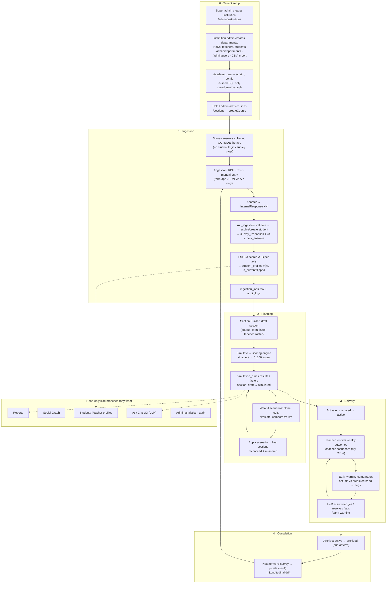
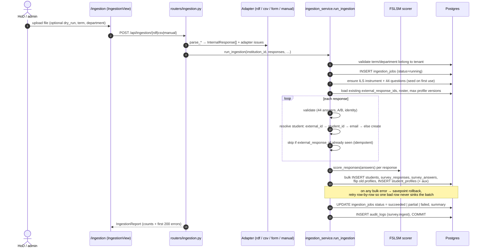
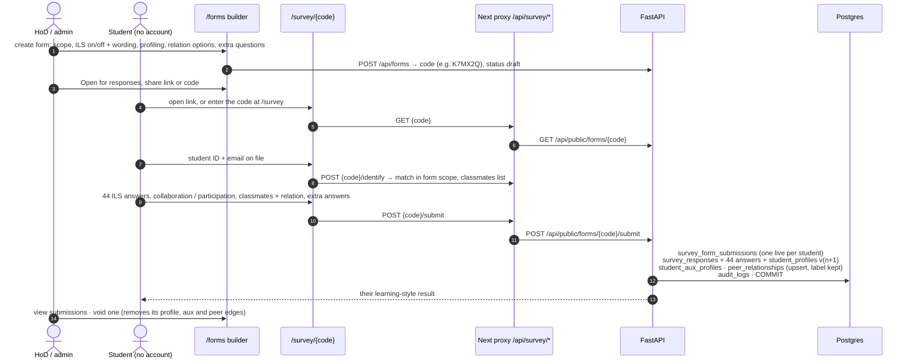
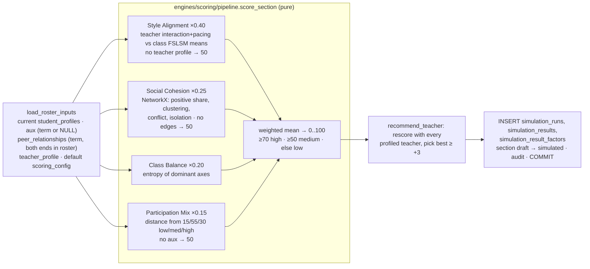
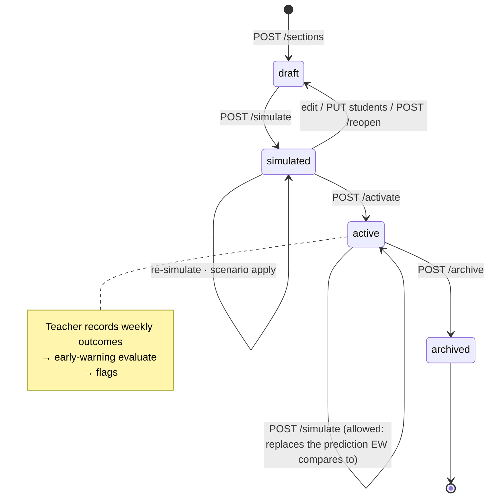

# ClassIQ — End-to-End Flow (Ingestion → Completion)

**Traced from code:** 23 November 2026, branch `development` @ `fd84d9d`.
**Scope:** what a real institution does, step by step, from an empty tenant to an archived
semester, and which page, API route, service and table each step touches.
**Related:** [BACKEND_ARCHITECTURE.md](BACKEND_ARCHITECTURE.md) · [DATA_MODEL.md](DATA_MODEL.md) ·
[PRODUCT_READINESS_REVIEW.md](PRODUCT_READINESS_REVIEW.md)

> Everything below was traced in the source unless it is marked **(untraced)**. Read paths are
> marked **RLS**: the browser queries Supabase directly with the publishable key and Row-Level
> Security applies. Write paths are marked **API**: FastAPI, which verifies the Supabase JWT and
> connects as `postgres` (bypassing RLS, so it scopes every query by `institution_id` itself).

---

## 1. The whole flow at a glance

---

## 2. Stage by stage

### Stage 0 — Tenant setup

| # | Who | Page | Path | Backend / tables | Notes |
|---|---|---|---|---|---|
| 0.1 | super_admin | `/admin/institutions` | API `POST /api/admin/institutions` | [admin_institutions.py](../backend/app/routers/admin_institutions.py) → `institutions` | Creates the tenant only, with no term, departments or config. |
| 0.2 | institution_admin | `/admin/departments` | API `/api/institution/departments` (+ `/hods`) | [institution_departments.py](../backend/app/routers/institution_departments.py) → `departments`, `user_departments` | HoD assignment. |
| 0.3 | institution_admin, HoD (students/teachers only) | `/admin/users`, Create Student / Teacher modals | API `POST /api/institution/users` | [institution_users.py:64](../backend/app/routers/institution_users.py:64) → `students` (roster row, **no auth account**) or Supabase Auth invite + `auth_users` + `teachers` | A new teacher gets a `teachers` row but **no `teacher_profiles` row** ([institution_users.py:186](../backend/app/routers/institution_users.py:186)). |
| 0.4 | institution_admin | `/admin/users/import` | API `/api/institution/users/import/preview` → `/commit` | [institution_users_import.py](../backend/app/routers/institution_users_import.py) | Bulk roster/staff CSV import. |
| 0.5 | — | none | SQL | [seed_minimal.sql](../db/seed_minimal.sql) → `academic_terms`, `scoring_configs` | **No API or page creates an academic term.** A global default scoring config comes from the seed. Section creation needs a term, and simulation fails cleanly without a config ([compatibility_service.py:162](../backend/app/services/compatibility_service.py:162)). |
| 0.6 | HoD / admin | `/sections` (createCourse action) | API `/api/institution/courses` | [institution_courses.py](../backend/app/routers/institution_courses.py) → `courses` | Audited. |

Auth for every API call: `Authorization: Bearer <Supabase JWT>` → [deps.py:42](../backend/app/deps.py:42)
`current_user` (signature, issuer, audience, expiry, subject, `is_active`) → `require_role(...)` gate.
The tenant is always `user.institution_id`.

### Stage 1 — Ingestion (survey → learning-style profile)

| Source | Route | Adapter | Identity used | `external_response_id` |
|---|---|---|---|---|
| RDF/XML (OWL) dump | `POST /api/ingestion/rdf` ([ingestion.py:108](../backend/app/routers/ingestion.py:108)) | [rdf_parser.py](../backend/app/ingestion/rdf_parser.py) | email only | `rdf:<individual name>@term:<term_id>` |
| ClassIQ CSV export | `POST /api/ingestion/csv` ([ingestion.py:133](../backend/app/routers/ingestion.py:133)) | [csv_adapter.py](../backend/app/ingestion/csv_adapter.py) | external_id, then email | `response_id` column (global), or a hash of identity + answers + `@term:<term_id>` |
| Form-app JSON | `POST /api/ingestion/form` ([ingestion.py:158](../backend/app/routers/ingestion.py:158)) | [form_app_adapter.py](../backend/app/ingestion/form_app_adapter.py) | external_id, then email | `response_id`, or a hash including `submitted_at` |
| Manual entry | `POST /api/ingestion/manual` ([ingestion.py:179](../backend/app/routers/ingestion.py:179)) | [manual_admin_adapter.py](../backend/app/ingestion/manual_admin_adapter.py) | existing student id, external_id or email | `manual:<who>:<timestamp>` (always new) |

- All four routes use the **staff gate** (HoD, institution_admin, super_admin). The form route is API-only; no page calls it.
- **Survey forms (added 23 Nov 2026)** are the student-facing path. See §1b below.
- **Scoring** ([scorer.py:92](../backend/app/engines/fslsm/scorer.py:92)): question *n* belongs to axis `(n−1) mod 4`.
  The axis score is `count(A) − count(B)`, an odd integer from −11 to +11. `dominant_axis` is
  the axis with the largest |score|.
- **Versioning:** each accepted response adds `student_profiles.version = max+1` and flips the
  prior row's `is_current` to false. Raw answers are kept, so profiles can be re-scored.
- **Aux profile** (`collaboration_pref`, `participation_level`) is written only when the source
  supplies it: CSV columns, the form `aux` object, or manual-entry fields. **RDF never does.**
- **Outputs used downstream:** `students`, `student_profiles (is_current)`, `student_aux_profiles`, `ingestion_jobs`.

Not produced by the batch ingestion paths: **`teacher_profiles`** and **`peer_relationships`**.
Survey forms now write peer relationships. Teacher profiles are still written only by
[seed_demo_data.mjs](../db/seed_demo_data.mjs).

### Stage 1b — Survey forms (student self-service)

| Piece | Where |
|---|---|
| Migration (tables, RLS: staff-only SELECT, no browser writes, nothing for anon) | [2026-11-23_survey_forms.sql](../db/migrations/2026-11-23_survey_forms.sql), tested in [survey_forms.test.mjs](../db/tests/survey_forms.test.mjs) |
| Staff API `/api/forms` | [routers/forms.py](../backend/app/routers/forms.py) |
| Public API `/api/public/forms/{code}` (no auth; tenant from the form only) | [routers/public_forms.py](../backend/app/routers/public_forms.py) |
| Logic: identity, peer validation, writes, void | [services/form_service.py](../backend/app/services/form_service.py) |
| Question wordings (`rdf` bundled; `standard` from a licensed `ils_standard_stems.json`) | [ils_instrument.py](../backend/app/ingestion/ils_instrument.py) |

- **Relation options:** each custom label ("Lab partner") maps to one of the four base types and a
  strength from 1 to 5, because the social-cohesion factor scores by type. The label is stored on the edge.
- **Profiling:** collaboration preference and participation level feed the Participation factor.
  Custom questions are stored on the submission and shown to staff, but are not scored.
- **Identity:** the student ID and the email on file must both match, inside the form's scope (a
  section roster, a department, or the whole institution). This is weak proof, so staff can void
  a submission. Peer questions require a section or department scope, and classmates are listed
  only after an identity match.

### Stage 2 — Planning (sections, simulation, scenarios)

**2a. Build a section** in `/sections` (SectionsView), API `POST /api/sections` →
[sections.py:170](../backend/app/routers/sections.py:170) → `sections` (state `draft`) and `section_students`.
Editing goes through `PATCH /api/sections/{id}` (label, teacher) and `PUT /api/sections/{id}/students` (roster).
Both are refused on active or archived sections. A simulated section that is edited drops back to `draft`.

**2b. Simulate**: `POST /api/sections/{id}/simulate` → [sections.py:293](../backend/app/routers/sections.py:293) →
[compatibility_service.simulate_section](../backend/app/services/compatibility_service.py:437):

**2c. What-if scenarios** in `/scenarios` (ScenariosView), API `/api/scenarios`
([scenario_service.py](../backend/app/services/scenario_service.py)):
`POST /from-section/{id}` (clone a live section) or `POST /` → edit → `POST /{id}/simulate`
(one run, one result per scenario section; [scenario_service.py:376](../backend/app/services/scenario_service.py:376)) →
`GET /{id}/compare` (side by side against the live baseline, with factor deltas and roster diff; [:505](../backend/app/services/scenario_service.py:505)) →
`POST /{id}/apply` ([:604](../backend/app/services/scenario_service.py:604)). Apply locks the scenario
and its destination sections, refuses active or archived destinations, rewrites the teacher and
roster on the matching live section (or creates one), re-simulates every touched section and
commits once. If any re-score fails, the whole apply rolls back.

### Stage 3 — Delivery (active semester)

Transitions are defined in [repositories/sections.py:420](../backend/app/repositories/sections.py:420).
A draft section cannot go straight to `active`, and an active section cannot be deleted (archive it instead).

| # | Who | Page | Path | Backend / tables |
|---|---|---|---|---|
| 3.1 | HoD | `/sections` | API `POST /api/sections/{id}/activate` | `sections.state = active` + audit |
| 3.2 | teacher (own sections) or staff | `/teacher-dashboard` (OutcomeEntry) | API `POST /api/early-warning/sections/{id}/outcomes` | [early_warning_service.record_outcomes](../backend/app/services/early_warning_service.py:193) upserts `section_outcomes` (section, student or NULL for the class, week). By default it then evaluates. |
| 3.3 | same | — | API `POST /api/early-warning/sections/{id}/evaluate` | [evaluate_section](../backend/app/services/early_warning_service.py:261) → [engines/early_warning.evaluate](../backend/app/engines/early_warning.py:71) |
| 3.4 | HoD / admin | `/early-warning` | API `GET /overview`, `GET /flags`, `PATCH /flags/{id}` | `early_warning_flags` status open → acknowledged → resolved (or reopen) |

**Comparator logic.** The latest `predicted_outcome` selects a band:
high = 85 % attendance / 70 % grade, medium = 75 / 55, low = 65 / 45.
For each student it averages the last 3 recorded weeks. Attendance below the band opens an
`engagement` flag, a grade below the band opens a `performance` flag, and a low engagement
level opens another `engagement` flag. One section-level `compatibility` flag opens when at
least 40 % of assessed students are under the grade band, or the class mean is 10 points or
more below it. On each evaluation, flags still produced are refreshed and flags no longer
produced are auto-resolved.

### Stage 4 — Completion

| # | Who | Path | Effect |
|---|---|---|---|
| 4.1 | HoD | API `POST /api/sections/{id}/archive` | `active → archived`. The section is frozen and cannot be re-simulated ([compatibility_service.py:460](../backend/app/services/compatibility_service.py:460)) or edited. |
| 4.2 | staff | `/ingestion` next term | A new response creates profile `v(n+1)` for the same student. |
| 4.3 | staff | `/longitudinal` → API `GET /api/analytics/longitudinal` ([longitudinal.py:125](../backend/app/routers/longitudinal.py:125)) | Cohort drift per term or version, plus the biggest individual shifts. Per student: `GET /api/students/{id}/profile-history`. |

There is no "close term" action. Archiving is per section, and the active term flag on
`academic_terms` is changed in SQL.

### Side branches (read-only)

| Feature | Page | Path |
|---|---|---|
| Dashboard, students, teachers, sections list, reports | `/`, `/students`, `/teachers`, `/sections`, `/reports` | **RLS** reads; `GET /api/reports/sections/{id}` exists for export and LLM context ([reports.py:93](../backend/app/routers/reports.py:93)) |
| Social graph | `/social-graph` | **RLS** read of `peer_relationships` |
| Ask ClassIQ | `/ask` | API `POST /api/llm/query` ([llm.py:46](../backend/app/routers/llm.py:46)) → [llm/context.build_snapshot](../backend/app/llm/context.py:105) → Groq or Anthropic |
| Institution analytics, audit | `/admin/analytics`, `/admin/audit` | API `/api/institution/analytics/*`, `/api/institution/audit` |
| Platform health | `/admin/system` | API `/api/admin/system/*` (super_admin) |

---

## 3. Review findings

### 3a. New findings, verified in this pass

| Sev | Finding | Evidence | Consequence |
|---|---|---|---|
| **High — partly addressed** | **For a non-demo tenant, every score lands between 40 and 60 and is never "high".** *Survey forms now collect peer relationships and participation, so the Social Cohesion and Participation factors get real inputs. Teacher profiles still have no writer.* Before forms, no API wrote `teacher_profiles` or `peer_relationships`, and RDF carries no aux data. Style Alignment, Social Cohesion and Participation therefore all default to 50. | [style_alignment.py:62](../backend/app/engines/scoring/style_alignment.py:62), [social_cohesion.py:32](../backend/app/engines/scoring/social_cohesion.py:32), [participation.py:13](../backend/app/engines/scoring/participation.py:13); grep finds no writer outside `seed_demo_data.mjs` | Score = 40 + 0.2 × Class Balance, so it can only be `low` or `medium`. Teacher recommendations never appear (candidates without a profile are skipped, [compatibility_service.py:356](../backend/app/services/compatibility_service.py:356)). The early-warning band follows from that, so the flow "completes" mechanically but on placeholder inputs. *(Extends readiness-review P1s; the arithmetic consequence is new.)* |
| **Medium — fixed** | **Early-warning flags duplicate and go stale.** *Fixed: flags are now keyed on `(student, type, metric)` (section flags on type only), new flags join the key map as they are created, and leftover duplicates are resolved, keeping the oldest. Covered by `tests/services/test_flag_reconciliation.py`.* One student can produce two `engagement` drafts (attendance and engagement level) under the same `(student_id, type)` key, which reconciliation uses as identity. | Confirmed at engine level: `evaluate()` with attendance 60 %, engagement "low", predicted high returns two `engagement` drafts. Service behaviour follows from reading [early_warning_service.py:307](../backend/app/services/early_warning_service.py:307) and [:348](../backend/app/services/early_warning_service.py:348); it was not run against a DB. | The first evaluation inserts **two** open rows (`by_key` is not updated inside the loop). Later evaluations write both drafts into the **same** row, so the attendance message is overwritten by the engagement message. The other row is never updated and never auto-resolved while either condition holds. No unique constraint exists on flags, so nothing raises an error. Fix: key on `(student_id, type, metric_name)`, or merge the drafts. |
| **Medium — fixed** | **RDF re-import for a new term is silently treated as duplicate.** *Fixed: ids derived from the respondent (RDF names, hashed CSV rows) are stored as `<id>@term:<term_id>`. Rows stored earlier with the bare id still count as duplicates in their own term. Explicit CSV/form `response_id`s stay global. Covered by `tests/services/test_ingestion_term_scope.py`.* The RDF id is `rdf:<individual name>`, and idempotency is per institution and instrument, not per term. | [rdf_parser.py:123](../backend/app/ingestion/rdf_parser.py:123), [ingestion_service.py:386](../backend/app/services/ingestion_service.py:386) | A second-term RDF dump with the same individuals returns `responses_duplicate = N` and creates no new profile versions, so Longitudinal stays flat. CSV rows without `response_id` behave the same way when the answers are unchanged. |
| **Medium** | **Early warning has no section-state guard.** Outcomes and evaluate run on `draft` or never-simulated sections, which fall back to the "medium" band. Re-simulating an `active` section is allowed and silently changes the prediction the flags are judged against. | [early_warning.py router `_section_for`](../backend/app/routers/early_warning.py:45), [engines/early_warning.py:88](../backend/app/engines/early_warning.py:88), [compatibility_service.py:460](../backend/app/services/compatibility_service.py:460) | Flags can cite a "predicted-medium section" that was never predicted. Mid-term re-scores move the goalposts. Consider requiring `active` for outcomes, and pinning the prediction at activation. |
| **Low** | **Academic terms can only be created in SQL.** No route or page creates `academic_terms` or switches the active term. | grep: no `AcademicTerm(` outside models; seed only | A new institution cannot create a section (term required) without SQL. This blocks a self-serve pilot. |
| **Low** | **The default term is chosen non-deterministically** when no term is given and several terms are active (`.limit(1)` with no `ORDER BY`). | [ingestion_service.py:344](../backend/app/services/ingestion_service.py:344) | Responses can be attached to the wrong term. |
| **Low** | **The README migration list omits `2026-11-19_student_academic_fields.sql`.** `schema.sql` already has the columns, so fresh installs work, but existing databases updated from the README do not get the department, program, batch and semester columns. | [README.md](../README.md), [schema.sql:167](../db/schema.sql:167) | Student creation with the new fields fails on an un-migrated database. |

Backend test suite: **209 passed, 5 skipped** after both fixes (the skipped tests need `TEST_DATABASE_URL`).
The new tests use stub sessions and have not been run against a real database.

### 3b. Already tracked in PRODUCT_READINESS_REVIEW.md (still open in code)

- P1: HoD department and teacher section scoping is not enforced in the API, RLS or LLM snapshot.
- P1: No teacher-profile, survey or peer-data collection workflows (root cause of the first finding above).
- P1: Missing-data defaults are invisible, and runs don't snapshot their inputs.
- P1: Early-warning thresholds are unvalidated, and teacher recommendations ignore subject, workload and availability.
- P1: No password set/reset completion flow, CI/release gates or LLM budgets.

### 3c. Doc drift

[BACKEND_ARCHITECTURE.md](BACKEND_ARCHITECTURE.md) §2 and §12 mention `core/logging.py`, `structlog`
and Alembic (`backend/alembic/`), and §2 mentions `twins`, `simulations` and `auth` routers and
a `report_service`. **None of these exist in the tree (untraced).** Migrations are plain SQL run
by [db/run_migrations.mjs](../db/run_migrations.mjs).

---

## 4. Minimum path for a demo that "completes"

1. `db/`: run `schema.sql`, `migration_institution_admin.sql`, `auth_trigger.sql`, `seed_minimal.sql`, all files in `migrations/`,
   then `seed_demo_data.mjs` (the only source of teacher profiles and peer edges).
2. Log in as HoD → `/ingestion` → upload `Data_File_Collected_Data_for_KG_in_RDF_Triples.rdf` (dry run first).
3. `/sections` → create a section with a profiled teacher and students → **Simulate**.
4. `/scenarios` → clone → swap teacher or students → simulate → compare → apply.
5. `/sections` → **Activate**.
6. Log in as that teacher → `/teacher-dashboard` → record week 1–3 outcomes.
7. HoD → `/early-warning` → acknowledge or resolve flags. `/reports`, `/social-graph`, `/ask` along the way.
8. `/sections` → **Archive**. Re-import a survey for the next term (the same RDF file now works when a different term is selected) → `/longitudinal`.
