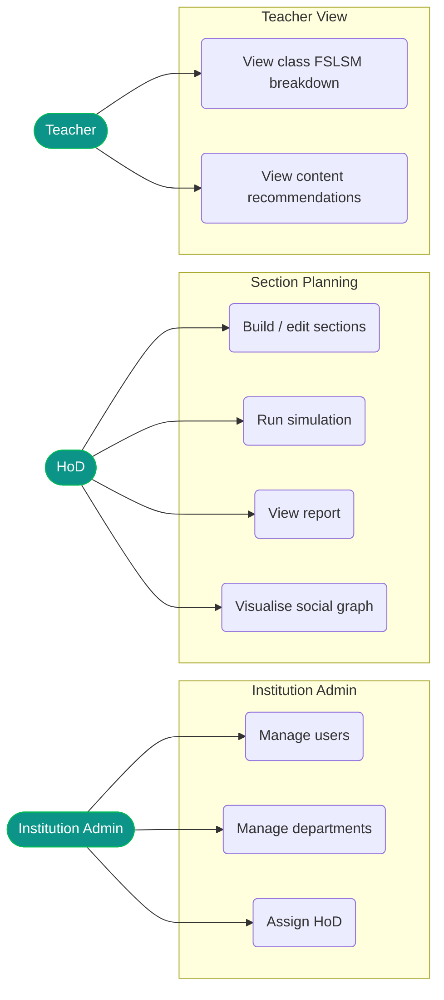
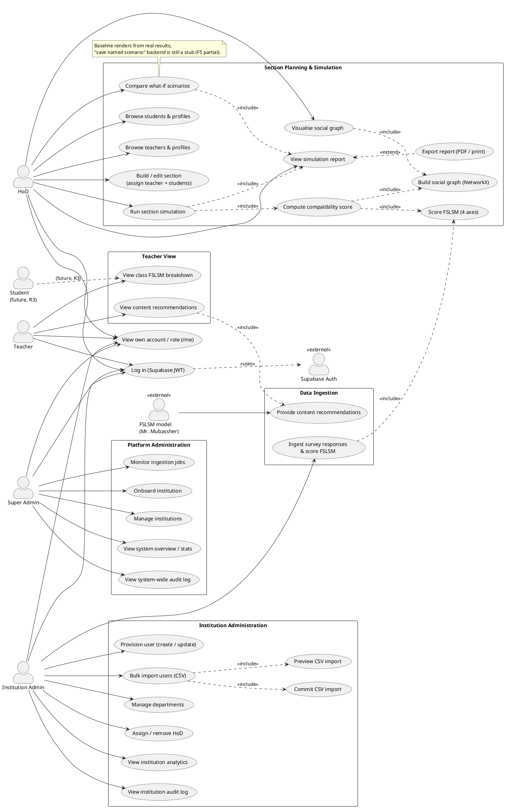
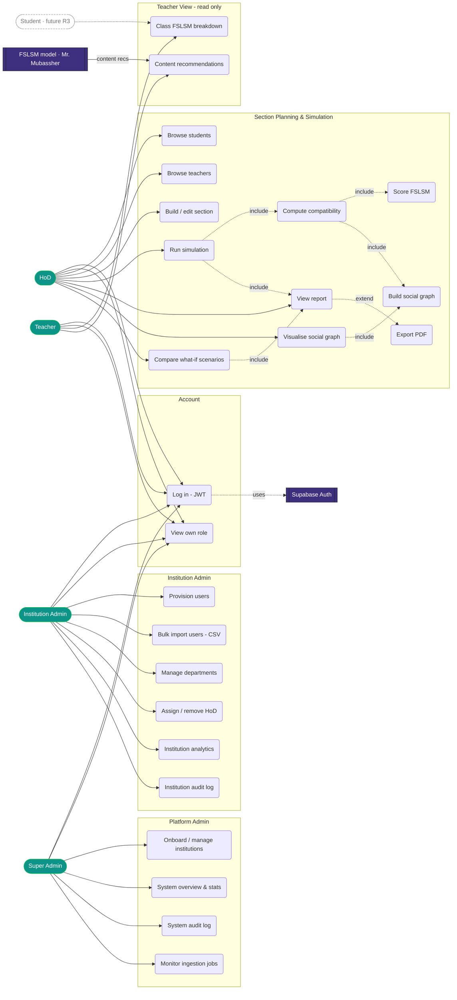

# ClassIQ — Use Case Diagram

> AI-Powered Digital Twin Platform for Classroom Intelligence
> Derived from `project.md` (features F1–F8, §15 User Roles) and the implemented
> FastAPI routers + Next.js pages. Last updated 3 June 2026.

## Actors

| Actor | Type | Notes |
|-------|------|-------|
| **Super Admin** | Human (platform) | Onboards institutions, monitors the whole platform. |
| **Institution Admin** | Human (tenant) | Manages users, departments, HoD assignment within one institution. |
| **HoD** (Head of Dept.) | Human (department) | Primary planner — builds sections, runs simulations, reads reports. |
| **Teacher** | Human (read-only) | Views the FSLSM breakdown + content recs for their own sections. |
| **Student** | Human (future, R3) | Post-FYP read-only self view — **out of current scope**, shown dashed. |
| **Supabase Auth** | External system | Issues/verifies JWTs; backs the *Log in* use case. |
| **FSLSM (Mr. Mubassher)** | External | Provides the FSLSM model + teaching content recommendations. No external app to integrate — ClassIQ collects its own surveys. |

Role inheritance: privileges are cumulative — **Institution Admin** inherits the
authenticated-user cases, **HoD** acts within a department, **Teacher** is the most
restricted. Each actor below lists only the cases *added* at that level.

---

## Simplified Use Case Diagram (Mermaid)

> A high-level overview of the three core roles and what each does.

---

## UML Use Case Diagram (PlantUML)

> Render at <https://www.plantuml.com/plantuml> or with the PlantUML VS Code extension.

---

## Quick-view version (Mermaid)

> Mermaid has no native UML use-case notation, so this is a grouped graph
> approximation for rendering inline in Markdown/GitHub.

---

## Traceability — use case → implementation

| Use case | Backend endpoint(s) | Frontend page |
|----------|---------------------|---------------|
| Log in | Supabase JWT (verified in `core/security.py`, `deps.py`) | `(auth)/login` |
| View own role | `GET /api/me` | sidebar / layout |
| Onboard / manage institutions | `GET/POST/PATCH /api/admin/institutions` | `admin/institutions` |
| System overview / audit / ingestion | `GET /api/admin/system/{overview,audit,ingestion-jobs}` | `admin/system` |
| Provision user | `GET/POST/PATCH /api/.../users` | `admin/users` |
| Bulk CSV import (preview→commit) | `POST /api/.../users/import/{preview,commit}` | `admin/users/import` |
| Manage departments | `GET/POST/PATCH /api/.../departments` | `admin/departments` |
| Assign / remove HoD | `POST/DELETE /api/.../departments/{id}/hods` | `admin/departments/[id]` |
| Institution analytics | `GET /api/.../analytics/{overview,…,score-trend}` | `admin/analytics` |
| Institution audit log | `GET /api/.../audit` | `admin/audit` |
| Browse students / teachers | `GET /api/students`, `GET /api/teachers` (+ Supabase-direct reads) | `students`, `teachers` |
| Build / edit section | `POST/PATCH /api/sections` | `sections` (Section Builder) |
| Run simulation | `POST /api/sections/{id}/simulate` | `sections` → `reports` |
| Compute compatibility / FSLSM / graph | `engines/scoring/*`, `engines/fslsm/scorer.py`, `engines/graph/networkx_builder.py` | — |
| View / export report | `GET /api/sections/{id}` + persisted results | `reports`, `ReportActions.tsx` |
| Visualise social graph | Supabase-direct reads + `peer` repo | `social-graph` |
| Compare what-if scenarios | baseline live; save-scenario **stub** | `scenarios` |
| Teacher class view | Supabase-direct reads | `teacher-dashboard` |
| Ingest survey & score FSLSM | `ingestion_jobs` + `engines/fslsm/scorer.py` (processor pending) | — |
| Content recommendations | external — Mr. Mubassher's FSLSM model | `teacher-dashboard` |

**Status caveats reflected in the diagram:**
- *Compare what-if scenarios* — baseline works; the save-named-scenario backend is a stub (F5 partial).
- *Data ingestion* — ClassIQ collects its own surveys; table + sources modelled, processor
  pending. There is **no external app** to integrate. Teaching content recommendations
  come from **Mr. Mubassher's FSLSM model** — the one external dependency.
- *Student* actor — dashed; R3 post-FYP, not in current scope.
- LLM / NL-query (S2), Early-warning (S1), Longitudinal (S3) — deferred, omitted here.
